### 👨‍💻 About Me

I'm a **Front-End Developer** with a strong passion for crafting elegant, user-friendly, and responsive web applications.

My journey started in **Mechanical & Mechatronics Engineering**, but I soon discovered my love for designing interactive digital experiences — and I've been building for the web ever since.

- 🔭 I'm currently working on **my personal portfolio page**
- 🌱 I'm currently deepening my knowledge of **TypeScript & Next.js**
- 👯 I'm looking to collaborate on **open-source projects on GitHub**
- 💬 Ask me about **Web Development, React, Next.js, or Tailwind CSS**
- ⚡ Fun fact: I came to code from an engineering background

---

### 🛠️ Tech Stack

**Languages & Frameworks**

  
  
  
  
  
  
  

**Tools**

  
  
  

---

### 📫 Connect With Me

  
  
  
  
  
  

---

     

---

### 📊 GitHub Stats

  

  

  

---

### 🏅 Badges

  
  
  
  
  

---

<i>⭐️ From <a href="https://github.com/MHShohag911">MHShohag911</a></i>

